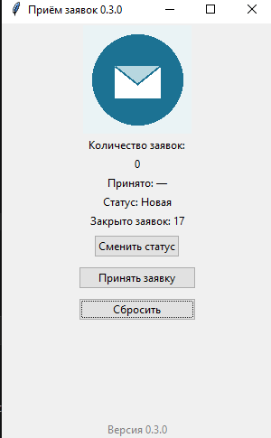

# Приём заявок

## Назначение
Назначается для приёма заявок и их смены статуса

## Как запустить

1. Нужен Python
2. Откройте терминал `Win + R` 
3. Там введите `cmd`
4. И в коммандной строчке введите `python app_v03.py`

## Как использовать 
* Чтобы дать заявку нажмите `принять заявку`

* Чтобы сменить этап готовности заявки нажмите `Сменить статус`

* Чтобы сбросить кол-во заявок нажмите кнопку `Сбросить`

## Интерфейс

